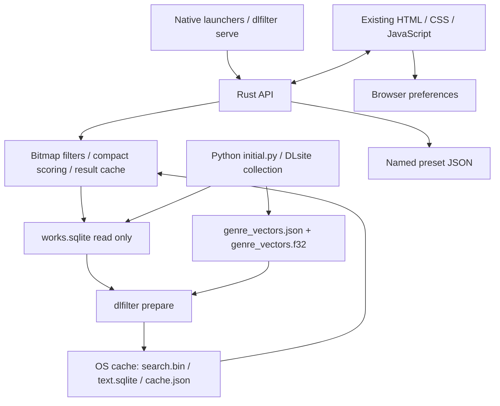

# DLFilter development reference

DLFilter collects DLsite catalogue data and serves one Search interface through a standalone Rust server backed by a read-only SQLite database and prepared search indexes. Keywords and hard filters narrow the candidate set; optional scoring genres rank those candidates by semantic similarity. This file records the current architecture, compatibility boundaries, validation, and remaining work for later development.

## Current development state

The unified search and BJ/VJ implementation was developed on 2026-11-15 from branch `release/2.0-update`, starting at `1d8964524f19637a3ccc6d5fa07aae8ce584ff4f`. Package and UI versions are 2.1. The serving path has since been migrated to Rust. Python is used for maintenance, tests, and the opt-in private background-title helper. The four top-level READMEs were left unread during the original code-first analysis; the later installation task inspected and shortened the English README. Translated READMEs remain unchanged.

Pre-existing changes to the installer, its tests, and `.DS_Store` were preserved. The installer's optional-file support was extended further for source progress and checkpoints. No production catalogue backfill, SQLite replacement, release, or publication was performed.

The existing local database remains an RJ-only snapshot: 459,699 works, 403 genre vectors of dimension 768, and latest release timestamp `2026-10-10 07:00:00`. Prefix support in code does not mean BJ/VJ works have been collected locally.

## Architecture



Search does not crawl DLsite or load the sentence-transformer model. Explicitly enabling background title collection starts a private helper that contacts DLsite for existing multilingual works. The browser still fetches external CSS/JS/fonts and product thumbnails. Model loading occurs only during genre embedding maintenance or opt-in diagnostics/tests. Search/setup do not initialize Python or scientific libraries. The opt-in helper contains Python, standard-library networking and a CA certificate bundle, without model/scientific dependencies.

## Source responsibilities

| Source | Role and connections |
| --- | --- |
| `app.py` | Small standard-library compatibility launcher for the Rust executable. |
| `src/main.rs`, `src/config.rs` | Native serve/prepare/doctor commands, path discovery and environment settings. |
| `src/api.rs` | Axum HTTP routes, validation, two-worker blocking bound and compatible response contracts. |
| `src/engine.rs` | Prepared metadata, FTS5 text index, bitmap filtering, exact genre scoring, page hydration and 64 MiB result cache. |
| `src/assets.rs` | Portable vector validation, hashes, dependency-aware fingerprints, atomic writes and database schema checks. |
| `src/presets.rs` | Native preset validation and atomic persistence. |
| `src/setup.rs` | First-run routing, streamed verified download/import, promotion journal, token/origin checks, job state, helper lifecycle and title collection controls. |
| `src/titles.rs` | Supplemental title SQLite/checkpoints, in-memory trigram index and preference persistence. |
| `templates/setup.html`, `static/setup.js`, `static/setup.css` | Four-language browser setup/settings and shared background progress link. |
| `module/title_lookup.py`, `scripts/title_helper.py` | Shared title URL/result handling and private JSON-lines collector, frozen into native releases. |
| `scripts/package_catalogue.py`, `scripts/package_release.py` | Portable serving ZIP/manifest generation and platform packaging/checksums. |
| `scripts/smoke_helper.py`, `scripts/smoke_release.py` | Offline private-helper and extracted-release checks without system tools on PATH. |
| `tests/reference/*` | Independent Python oracle, excluded from release bundles and unused by serving. |
| `module/products.py` | Maintenance-side product normalization and source registration; native equivalents live in the Rust engine. |
| `module/export_vectors.py` | Explicit trusted-pickle conversion and portable vector export during model maintenance. |
| `module/config.py` | Project-relative paths and environment configuration, independent of current working directory. |
| `module/dlsite.py` | Raw catalogue collection, per-source dates, resumable title/edition requests, rate limiting/retries, genre/format scraping and model embeddings. |
| `module/catalogue_store.py` | Transactional daily raw-record/source-progress checkpoint and replay over legacy JSON. |
| `initial.py` | CLI modes, source selection, date-span calculation, explicit backfills, genre/format merging, normalization and export. |
| `module/database.py` | Read-only SQLite access, nested serialization, localized-title/edition augmentation, validated temporary export and previous-file backup. |
| `module/fetch_database.py` | Allowlisted ZIP installer/downloader; accepts legacy archives and optional translation/progress/checkpoint files. |
| `module/doctor.py` | Environment, data schema, prefix coverage, thumbnail metadata, source progress and optional offline model diagnostics. |
| `recover_works_table_download.py` | Standalone legacy truncated-JSON salvage utility; does not modify source data. Its introductory command still uses an outdated filename. |
| `templates/index.html` | One Search panel, catalogue selectors, advanced controls, anchored copy popup content, presets, and one result section. |
| `static/script.js` | One browser state/request flow, additive copying, settings persistence, preset integration, localized controls, modal interactions, safe image URLs and prefix fallback paths. |
| `static/template.js` | One DOM-based card renderer for search and random results, optional score badges, title switches, and Copy tags actions. |
| `static/localisation.js` | Four UI languages and shared language/edition mappings. Genre and format labels come from the locale API. |
| `static/style.css` | Existing Bootstrap-based visual language, responsive panels/cards, popup bounds, theme styles, and five-item hard-filter indication. |
| `static/imgs/*` | Historical curve/screenshot assets; no active application references. |

## Search behavior and API contracts

`GET /api/search` accepts `q`, `field=all/title/artist/id`, `ages`, `page`, `page_size`, `genres`, `rj_id`, `categories`, `included_genres`, `excluded_genres`, `since`, `excluded_low_rate`, `excluded_options`, `weight_func`, and `dlcount`.

Genre/format/option lists are `+`-joined strings. `rj_id` is retained as a compatibility field name but accepts RJ, BJ and VJ. IDs have six or eight ASCII digits after normalization. Age flags are all-ages/R15/R18, mapped to values 1/2/3; `000` means any age.

- Keywords and all hard filters intersect. Whitespace-separated terms must all match allowed fields. NFKC and case folding handle width/case differences; SQL wildcard characters are literal.
- With scoring genres, all selected genres contribute. Candidates without complete usable tag vectors are skipped. The reference work is excluded only in this mode. Scores descend, then product ID breaks ties.
- With keywords and no scoring genres, the order is exact ID, exact title/circle, title prefix, then remaining matches, with title/ID ties.
- With neither keywords nor scoring genres, browse by release date descending, then product ID.
- Responses include total and complete formatted rows for the requested page (default/max 48). Scored rows add `score`; unscored rows omit it. There is no 240-result ceiling on unified search.
- `GET /api/random` samples uniformly without replacement from the eligible bitmap; it does not score or exclude the reference ID.
- `POST /api/similarity` remains a compatibility adapter to the same native engine, preserving ranked ID/score pairs, timing/candidate information and the 240-result cap.
- `GET /api/works` accepts repeated normalized `rj_id` parameters (max 50), includes `{}` for missing records, and returns `missing` IDs.
- `GET /api/locale/{locale}` localizes genres/formats, falling back to English. Backend metadata includes Korean; the UI supports English, Japanese, Traditional Chinese and Simplified Chinese.
- `GET /api/info` reports row count and SQLite file modification time in UTC, not the last collected release day.

First-visit UI defaults select All Ages, no genres/formats, all five exclusions enabled, and disabled weighting/date switches. API filter defaults retain compatibility with older direct clients; the browser explicitly sends its checkbox states.

Required genres and excluded genres each retain a five-item effective limit. Their controls stay accessible with no scoring genres. Empty format selection means all formats. Weighting controls remain saved but unavailable until scoring genres exist.

Genre scoring averages count-scaled embeddings by number of tags, then calculates cosine similarity. Weight values 1/2/3/4 map to reverse-logistic/logistic/Gaussian/constant; UI positions map to `[1,4,2]`. Download weighting is bypassed at 50 and otherwise multiplies by a capped shifted-normal density ratio with mu 2.09 and std 1. Percentages are similarity scores, not probabilities.

## Native search preparation

Build with `cargo build --release --locked`, then use `dlfilter prepare`, `dlfilter serve --open`, or `dlfilter doctor`. The launchers select `bin/dlfilter` from a native package or the locally built `target/release/dlfilter` (`.exe` on Windows). They do not install Python or download models/data during normal startup.

For legacy data, explicitly convert the trusted local pickle once:

```sh
uv run --extra convert --no-dev python -m module.export_vectors --trusted-pickle database/genre_vec.pkl --output database
```

This adds `genre_vectors.json` and `genre_vectors.f32`, retaining the original pickle. Python genre embedding generation exports the portable files automatically. Rust checks the format version, sorted unique IDs, dimensions, checksum and finite vector values and never deserializes pickle.

Prepared assets live under the OS application cache directory, overridable with `DLFILTER_CACHE_DIR`. The source data directory can be read-only. `DLFILTER_ROOT` optionally identifies the directory containing static assets/templates. Cache generation uses a file lock, temporary files and checksummed atomic promotion. Its fingerprint covers source database path/identity/size/nanosecond mtime, genre/vector file hashes and Cargo.lock (including ICU normalization data versions). Stale, corrupted or incomplete generations rebuild. The first full preparation takes approximately 28 seconds on the measured catalogue; normal cached startup was about 0.61 seconds.

Search metadata excludes descriptions and display-only fields. Bitmap sets handle hard filters; existing date/title orderings avoid repeated sorting for browsing. Full case folding/NFKC happens during preparation and once per query. FTS5 trigrams narrow terms of at least three Unicode characters; short terms scan eligible normalized strings. Literal verification retains substring behavior. ID lookups use a map/prefix index. SQLite hydrates only the current page.

For scoring, the genre Gram matrix stores pairwise dot products. Four weighting modes have prepared per-work norms. Query genre contributions are summed over each candidate's compact tag list; mean factors cancel in cosine normalization. Float64 accumulation agrees with the original direct-vector calculation within the test tolerance `1e-5`. No approximate-neighbor search or dense work-vector matrix is used. Download weighting uses an equivalent stable exponential ratio. Ranked IDs/scores use a memory-accounted 64 MiB LRU, excluding page number and coalescing concurrent identical requests. At most two blocking requests execute concurrently. Catalogue generations stay immutable until server restart.

## Browser state and presets

`dlfilter.search.v1` stores `{version: 1, settings, language, theme}` in localStorage. Settings include keywords, field, reference, genres/formats, slider enabled/value pairs, age/content flags and advanced-panel visibility. The previous `lang` key remains compatible. Changes save immediately; storage failures do not prevent searching.

Restore waits for catalogue metadata, ignores unknown IDs, fills missing/default values, and does not run a search or copy tags. Reset restores defaults and persists them. Named/file presets update remembered settings. Date sliders store a relative position, so their effective cutoff changes over time.

The language switch again uses a persistent four-icon strip (1.35rem), with a 320 ms leftward transition and reduced-motion support. Theme icons are 1.6em inline SVG sun/crescent graphics. Underlined welcome links for keywords, genres and product formats highlight only their associated section on hover or keyboard focus; keyword activation focuses the search input. Delegated handlers survive localization/reset.

The popup accepts explicit Copy or Enter, adds/deduplicates all known tags, preserves other filters, and remembers the latest reference. Missing/tagless/failed lookups preserve selection and reference. Escape closes it and restores focus; outside clicks dismiss it. Request counters reject stale search/copy results after reset, edits, or newer requests.

Named presets remain JSON files with keyword fields `q` and `field` added. Older presets receive defaults. The legacy `rj_id` name accepts all prefixes. GET/PUT `/api/presets/{name}` and GET `/api/presets` retain their roles, limits, and safe names. Download/upload icons represent the existing save/load operations, not automatic file download/upload.

## Catalogue maintenance and storage

Registered sources are `maniax`, `books`, `pro`, and `soft`. The former `comic` route redirects to Comipo and is not collected. Prefix does not uniquely identify an age category or source; retain actual `siteId` and age metadata.

| Data file | Contract |
| --- | --- |
| `works_table.json` | Legacy aggregate raw work dictionary keyed by product ID. |
| `dates_table.json` | Legacy maniax-only release-day → fetched timestamp map. |
| `source_dates_table.json` | Source → release-day → fetched timestamp. Legacy flat dates seed only maniax. |
| `catalogue_updates.sqlite` | Raw records plus completed source/day transactions. Replay overlays JSON at load, including after interrupted first-time collection. Preserve this file with raw data. |
| `title_table.json` | Product ID → language → localized title or completed negative `null`. |
| `translation_table.json` | Edition ID → edition/original metadata or negative `lang: null`. Failed requests are not successful negative lookups. |
| `genre_table.json`, `workformat.json` | Merged multilingual genre and format catalogues. |
| `genre_vec.pkl` | Legacy trusted maintenance-format vectors; never loaded by Rust. |
| `genre_vectors.json`, `genre_vectors.f32` | Portable manifest and little-endian float32 vectors consumed by native preparation. |
| `works.sqlite` | Serving database; table name remains `maniax` for compatibility across all product prefixes. |

Each successful daily checkpoint commits raw records and source/day progress together. It is replayable before aggregate JSON is saved. Aggregate JSON files use temporary-file replacement, with raw works saved before source progress. Overlapping products deduplicate by ID. Do not edit snapshot/checkpoint files independently or run multiple maintenance writers concurrently.

`initial.py -u NONE -s` updates sources with recorded history from their latest recorded day through yesterday. Uninitialized sources print explicit backfill instructions and are not silently crawled across historical dates. `-d START END --sources books pro soft` explicitly backfills selected sources. Initialization supports the same source selection. Existing `-i` with raw data prints dates and exits; it does not force rebuild.

Rebuild normalizes missing optional upstream fields, retains tagless works for browsing, and exports upstream `imageUrl`. Serving older databases uses `NULL` for absent optional columns and prefix thumbnail fallbacks: RJ/doujin, BJ/books, VJ/professional. Links use actual site metadata. Separate translated editions inherit statistics/tags from their originals but use their own metadata and thumbnail fallback.

Translation title lookups select the work's actual source. Edition listings iterate selected sources. Existing language/kind/worker/rate/limit controls remain: six workers, four product requests/second, one listing request/second, bounded retries, and saved results/checkpoints. `--limit` counts work tasks, not HTTP requests or listing pages.

SQLite export validates temporary output before moving the current file to `.bak` and promoting the new file. These are separate renames; stop the server before export and restart afterwards. Installer staging is also not a transaction across the entire data bundle. An already-installed archive is skipped unless `--force` is given, even if optional files are absent.

## Dependencies and operation

`Cargo.toml`/`Cargo.lock` define the native runtime. Use current stable Rust to build; CI checks formatting, Clippy, Rust unit tests and release compilation on Linux, Windows and macOS. No Rust compiler is required to use a packaged executable.

Python dependencies are maintenance-only: core `requests` for the archive installer, the `convert` extra for legacy NumPy pickles, and `update` for collection/model tooling. FastAPI/Uvicorn are development-only dependencies of the reference tests. `requirements.txt` is the generated maintenance pip alternative; `packages-before-model-fix.txt` is historical only.

The default Docker target is a native Debian serving image, with read-only `/data` and writable `/cache`/`/presets`. The separate `update` target contains Python tools. Compose's update profile selects it. Platform release workflows package native executables plus the source/frontend, but no release has been published by this task. Docker daemon was unavailable locally, so image builds remain unverified locally; CI includes Docker build checks.

```sh
cargo build --release --locked
cargo test --locked
cargo clippy --locked --all-targets -- -D warnings
uv sync --locked --all-extras
uv run --no-sync pytest -q
npm ci
npx playwright install chromium
npm run test:browser
```

Python tests retain the independent oracle under `tests/reference` and compare native local HTTP responses, not DLsite crawler responses. Browser tests execute the native server against temporary fixture data. The real catalogue benchmark runs with read-only source links and temporary caches/presets:

```sh
uv run --no-sync python scripts/benchmark.py --output benchmarks/local.json
```

The measured process high-water memory uses Unix `resource` in an isolated child monitor. The benchmark script therefore targets macOS/Linux; it is not part of the Windows test suite.

## Verification and development log

| Date | Work and evidence |
| --- | --- |
| 2026-11-15 | Original code-first analysis: runtime diagnostics passed; initial local tests had six missing-tqdm failures. Full extras resolved these, giving 127 passed / 1 model test deselected. |
| 2026-11-15 | Unified Search, persistent preferences, normalized RJ/BJ/VJ IDs, per-source collection/checkpoints and browser tests implemented. A first implementation checkpoint passed 141 Python tests and 5 browser scenarios. Final validation passed 146 Python tests (1 optional model test deselected) and all 7 browser scenarios. Live single-day books/pro/soft samples exported successfully as three temporary rows; runtime diagnostics confirmed the existing database was unchanged. Live genre/format metadata checks also passed for books, pro and soft. |
| 2026-11-15 | Rust serving migration and UI restoration completed. Final checks: 191 Python tests passed, 1 optional model test deselected; 4 Rust unit tests passed; all 8 browser scenarios passed against Rust. Formatting, Clippy and diff whitespace checks passed. Native diagnostics read the existing 459,699-work catalogue, and the default OS search cache was prepared successfully. The compatibility launcher imports with Python site packages disabled. Local Docker execution remains unavailable; image build jobs are configured in CI. |
| 2026-11-15 | Language glyph weight reduced to 400; moon redrawn as a slimmer crescent. Restored the 600 ms circular theme reveal from the switch, retaining reduced-motion cross-fade and immediate fallback when View Transitions are unavailable. Browser coverage checks both reveal directions and reduced motion. |
| 2026-11-15 | Welcome keywords, genres and product formats now fade their text/tint and section outline/tint in and out on hover or keyboard focus. Transitions preserve layout and are disabled for reduced motion. Result cards continue to be built in the browser by `catalogCardTemplate` in `static/template.js`, using native API JSON. |

Tests cover search validation, normalization, SQL literals, filters, ranking/pagination beyond 240, tagless browsing, translation title switches, presets, export safety, source progress/replay, failed checkpoints, legacy source migration, and installer allowlists. Browser scenarios cover additive copying above ten genres, popup anchoring/focus, restoration/reset, legacy presets, errors/stale responses, all languages, and desktop/mobile widths.

The optional real-model test remains excluded by default. A multi-year historical crawl and release publication are outside implementation validation.

## Remaining development considerations

- The optional real-model test remains excluded by default; actual model loading is maintenance validation, not a serving dependency.
- Cache preparation is deliberately more expensive than a request. Run `dlfilter prepare` after maintenance to avoid paying that cost at the next interactive launch.
- Restart after replacing SQLite or genre assets. Editing data in place while serving is unsupported.
- Raw JSON/checkpoint coexistence and future streaming exporter work remain maintenance concerns; do not remove history, backups or checkpoint data for search optimization.
- Docker builds and non-host platform runs are covered by configured CI, but have not been executed remotely in this session.
- Keep the four database guides current with CLI changes. Preserve unrelated edits and update this reference after meaningful behavior or compatibility changes.

## Rust migration measurements on 2026-11-15

Measured on the local Apple Silicon desktop, release build, 459,699 works, 20 repetitions per case. First-request timings use prepared indexes and warmed filesystem state; repeated timings include the native result cache. They measure local HTTP responses, not browser rendering or network crawling. These gains combine the new algorithm/indexes/cache with Rust, rather than isolating language overhead.

| Request | Python first request | Rust first request | Rust repeated p95 |
| --- | --- | --- | --- |
| Browse 55,209 all-age works | 256 ms | 2.54 ms | 0.65 ms |
| Short keyword | 1,249 ms | 9.28 ms | 0.60 ms |
| Long keyword | 1,201 ms | 4.69 ms | 0.59 ms |
| Similarity over 55,209 works | 624 ms | 3.27 ms | 0.57 ms |
| Random | 99 ms | 0.70 ms | 3.12 ms |

Native full-catalogue similarity first request took approximately 12 ms. Native process peak RSS was 409 MiB versus Python's 855 MiB. Cached native startup was 0.61 seconds; initial preparation took 28 seconds. All measured warm p95 values met the 150 ms target, slow cases exceeded the 3x target, and native peak memory met the 512 MiB target. See `benchmarks/local.json` for the full sample summary. Baseline Python startup before lazy scientific imports was 0.28 seconds; native startup preloads the search metadata.

Production work records, raw history and original genre pickle were preserved. Two portable vector assets were added to make the native launcher usable with the existing local data. No backfill, database replacement, merge or release publication was performed.

## Result-card rendering assessment (2026-11-15)

The browser builds 48 cards with `catalogCardTemplate` (jQuery DOM construction) and inserts them in `renderView`. The native server supplies JSON. A temporary Chromium/Playwright profile on the local desktop measured 18 renders of a 48-work fixture page, discarded three warm-up runs, and timed construction separately from insertion plus a forced layout. Initial medians: 2.8 ms construction, 2.8 ms insertion/layout; maxima: 4.6 ms and 3.8 ms. External DLsite images were blocked. These are warm fixture measurements, not image loading/decoding, paint, slow-device results, or an implemented Rust comparison.

Rust compiled to WebAssembly would still use browser DOM interfaces and introduce binding/string-transfer costs. There is little arithmetic in this renderer, so a performance gain is unproven and likely small. Rust-generated HTML on the server could reduce client-side construction but still requires browser HTML parsing/layout/paint and interaction code. It also moves locale/title-toggle markup and escaping responsibilities into a second layer. Keep the current renderer for now; if real-device profiling exposes a bottleneck, first compare native DOM/template cloning, defer hidden details, and measure image/layout costs before choosing a rewrite.

The welcome section highlight now extends 8 px around its target, with adjusted format-row gutters. The scrolling search-terms panel reserves space for the border so overflow clipping does not cut it off. The overlay does not move controls or intercept input; its fade and reduced-motion support remain.


## Browser installation and background titles (2026-11-15)

First launch now binds the local server before loading a catalogue. Missing/incompatible data opens `/setup`; valid data prepares in the background and enters Search. Existing source/CLI workflows remain available. The English README is 725 words; detailed installation/API material moved to `docs/installation.md` and `docs/api.md`.

Setup accepts an explicitly selected local ZIP or an explicitly requested manifest download. The serving manifest is version 1 with `url`, compressed `size`, and ZIP `sha256`. No new release/database artifacts have been published. Automatic downloads depend on publishing `serving-catalogue.json` and `works-serving.zip` to the configured database release; the README states this prerequisite. The generated local serving archive is `/tmp/dlfilter-serving-bundle/works-serving.zip` (210,039,390 bytes); its checksum is in that directory. It contains only five serving files, without raw history or pickle. A full-size streamed setup import into temporary storage successfully loaded all 459,699 works; the installed catalogue was not replaced.

Installation validates archive paths, duplicate known filenames, symlinks, declared/actual sizes, CRC, schema, SQLite quick_check, vectors, and metadata. Downloads are streamed with a size bound, SHA-256 verification, read timeouts and cancellation checks. Extraction is staged beside the data folder. A write-ahead promotion journal recovers interrupted renames and preserves any previous incompatible folder as `.before-setup`; an active catalogue cannot be replaced. Index preparation finishes after activation; closing/relaunching repeats it safely.

Title collection is opt-in and one sequential worker at at most two requests/second, with bounded retries and throttled 403/429 backoff. Only selected advertised multilingual titles for existing works are queried. Actual site routes (including home/girls) are retained. Failures are retryable, whereas successful empty results are saved. Pause and graceful server shutdown terminate the helper; enabled settings resume after restart. Title choices and progress are separate from browser search settings and presets.

The supplemental `titles.sqlite` and `catalogue-settings.json` live in the configured cache directory. Unlike regenerated search assets, these contain collected user data and should be retained/backed up. A committed lookup is a checkpoint. Publication acquires both API worker permits, updates supplemental metadata/FTS, and invalidates result-cache entries; existing requests finish before activation. Cache keys include the title revision. Keyword filtering, relevance ordering, random selection, similarity filtering, hydration and title switches use collected titles without rebuilding the main catalogue or genre vectors.

Platform CI now packages and smoke-tests native Windows x64, Linux x64, macOS arm64 and macOS Intel releases with the private helper. Normal-use Python/model installation is unnecessary. Local Apple Silicon review packaging passed extracted-app setup/import/search/frontend and helper checks with no system tools on PATH. One bounded live request through the frozen helper returned a valid empty translation result; nothing was written to production data. Non-host platforms and Docker still require CI execution; they have not been run remotely in this session.

Final browser-setup validation: 204 Python tests passed (1 optional model test deselected), 5 Rust tests passed, and all 10 browser scenarios passed. Formatting, Clippy, JavaScript syntax and documentation link checks passed. The extracted local review release and full-size temporary catalogue import also passed. Docker and non-host OS execution remain pending CI; no release or database artifact was published.

GitHub validation after the initial push: Linux and Apple Silicon packaged-app checks passed. Docker exposed a missing build-stage `binutils` dependency, now included. Python float32 reference near ties vary across BLAS kernels; native contract checks compare scores by work ID, enforce meaningful ordering and native exact-tie ID order. Browser copy helpers now await the popover opening event before entering another ID; failure traces are retained.

## v2.0 release preparation

Publication was explicitly requested on 2026-11-15. Package/UI versions are aligned to 2.0.0/2.0 and the serving manifest is pinned to the v2.0 release, alongside its native app ZIPs. The legacy maintenance installer points to the existing `Databases/database.zip` asset. Native and serving ZIP checksums accompany their assets. The serving bundle retains the existing RJ-only coverage and does not imply a BJ/VJ backfill. The previously green cross-platform run is https://github.com/charasleeping/DLfilter/actions/runs/43716030293. No production catalogue regeneration is required for publication.
